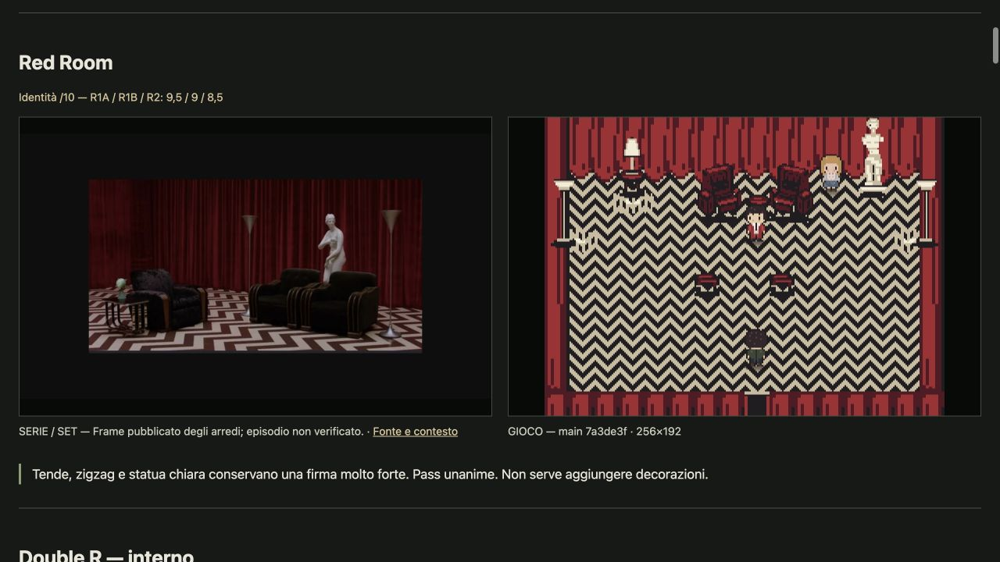

# Riconoscere Twin Peaks nel gioco

## Esito

Il gioco conserva bene il vocabolario della Red Room. Il Double R è un altro punto forte, ma non supera all'unanimità la soglia di riconoscibilità. Negli altri luoghi il giocatore capisce spesso **che tipo di posto** sta visitando; non sempre capisce **quale posto della serie**.

Il problema principale non è la quantità di dettagli. Sono le grandi superfici, le sagome e le relazioni che distinguono un luogo da un altro. La Camera 315 sembra una camera d'albergo; il suo grande piano freddo, però, non restituisce l'involucro di legno della reference. Il Great Northern sulla mappa sembra una piccola costruzione: perde la relazione fra grande lodge, dislivello e cascata.

**Audit concluso; bar visiva non raggiunta in tutti i luoghi. Nessuna modifica artistica.** Questo è un giudizio visivo di agenti, non un risultato misurato su fan della serie.

[Apri la galleria serie / gioco](../artifacts/tv-recognition-review/index.html). Le immagini del gioco sono render reali, non mockup.

## Quale versione abbiamo giudicato

- Base: `main` / `origin/main`, commit `7a3de3fd249cc908756a269e116c597bc82f1767`.
- Lavoro isolato: `codex/tv-recognition-audit`, worktree `.worktrees/tv-recognition-audit`.
- 12 luoghi fisici, 13 catture base: Palmer compare in due stati. Quattro catture aggiuntive documentano candidate su altri branch; **non vengono presentate come modifiche già integrate**.
- Checkout principale sporco e versione online esclusi: non possiamo dedurre che corrispondano a `main`.
- Nessun cambiamento a `environment.program`, mappe, arte, collisioni, porte, Cast Presence o narrativa. Double R rimane congelato per il playtest umano.

Ogni cattura usa `index.html`, canvas di produzione **256×192**, tile 16, camera reale e posizione diagnostica verificata walkable. Boot nuovo per scena, fixture canoniche tramite il probe già esistente, 900 ms di assestamento. Non è una prova di ingresso camminato né di campagna completata; la fase delle animazioni non è congelata. Coordinate, attori, flag, commit, timestamp e SHA-256 sono nei JSON di cattura.

La seconda immagine Palmer si chiama `palmer-evening.png`, ma lo stato è `ACT4_AFTERNOON`: il nome del file non certifica una variante notturna. È pixel-identica ad `ACT1_TOWN` in questo setup. Non deduciamo un bug temporale da due screenshot.

## La reference giusta

Le tavole in `assets/ref` sono concept pixel-art: utili per lo stile, **non sono fotogrammi della serie**. Confonderli con la fonte televisiva farebbe misurare la fedeltà a un'interpretazione precedente, non a Twin Peaks.

Per Double R, reception dello Sheriff, lobby e Roadhouse abbiamo usato fotografie dei set pubblicate dal production designer [Richard Hoover](https://www.richardhooverdesign.com/twinpeaks). Per Palmer abbiamo separato i [fotogrammi del Pilot](https://twinpeaksblog.com/2020/02/24/then-and-now-the-palmer-house-interiors-in-september-2019/) dalle fotografie della casa nel 2019. One Eyed Jacks usa [inquadrature degli episodi 1.002 e 1.006](https://twinpeaksblog.com/2018/07/01/twin-peaks-location-one-eyed-jacks/).

Camera 315 dispone di una sola [inquadratura bassa di S2E1](https://talkfilmsociety.com/television/twin-peaks-rewatch-project-season-2-episode-1-to-episode-5): permette di giudicare il materiale dominante, non di ricostruire la pianta. La [reference Red Room](https://bluerosearchive.com/analysis/red-room/) documenta gli arredi visibili, ma l'episodio esatto non è stato stabilito indipendentemente. La geometria non visibile resta fuori dal giudizio.

Gli esterni usano fotogrammi del Pilot: [Double R](https://twinpeaksblog.com/2018/04/29/setting-the-stage-double-r-diner-exterior/), [Sheriff](https://twinpeaksblog.com/2018/04/20/setting-the-stage-twin-peaks-sheriffs-department-exterior-season-1/), [Great Northern](https://twinpeaksblog.com/2018/06/07/setting-the-stage-the-great-northern-hotel-exteriors/). Il [Grove](https://twinpeaksblog.com/2020/01/13/twin-peaks-film-location-complete-guide-to-glastonbury-grove/) usa un fotogramma mattutino di S2E22; il diverso orario non è di per sé un difetto del gioco.

Correzione importante: un URL MovieMaps terminava in `/images/kx` anziché [`/images/kxw`](https://moviemaps.org/images/kxw). La prima pagina era sbagliata; la fotografia originale era davvero Salish/Great Northern. Anche il mio sospetto temporaneo di Kiana/Blue Pine era sbagliato ed è ritirato. Il giudizio finale usa comunque il più chiaro establishing shot del Pilot. Nessun errore di fonte viene trasformato in difetto artistico.

[Provenienza delle immagini](../artifacts/tv-recognition-review/sources.json), [manifest SHA-256](../artifacts/tv-recognition-review/evidence-manifest.json). Diritti delle reference ai rispettivi titolari; raccolta per confronto critico, non per riutilizzo come asset.

## Loop con critic indipendenti

Tutti i subagent richiesti usano **Luna xhigh**, contesto fresco. Nessuno costruisce o modifica l'arte che giudica.

| Passaggio | Agent | Materiale e compito |
|---|---|---|
| Ricerca | `tv_reference_audit` | Individuare fonti reali, versioni e limiti; nessun voto artistico. |
| R1A | `tv_interiors_critic_r1a` | Otto interni, immagini reference + render; identità, materiale/composizione, leggibilità, una lacuna principale. |
| R1B | `tv_interiors_critic_r1b` | Stesso confronto indipendente, senza leggere R1A. |
| R2 | `tv_integrated_critic_r2` | Tutti i 12 luoghi e quattro candidate, senza leggere i voti R1; verifica di identità specifica e confronto con le candidate. |
| Review ostile finale | `tv_report_final_review` | Controllo indipendente di voti, fonti, hash, link e affermazioni del report; nessun nuovo voto artistico. |
| Controllo finale | Lead | Ispezione diretta delle immagini, controllo delle fonti, correzione delle inferenze non supportate. Nessun nuovo voto inventato. |

Il loop migliora **la review**, non l'arte: cattura 315 rifatta senza dialogo sovrapposto; riferimento dell'hotel chiarito; ipotesi di camino in 315 rimossa perché l'immagine non la supporta. Non abbiamo finto iterazioni di build.

La review ostile finale ha inoltre trovato due affermazioni eccessive nelle note R1: una presunta variante notturna Palmer e una prescrizione di pavimento 315 non sostenuta dall'angolo disponibile. Corrette dal lead con errata esplicita nelle note, **voti invariati**. Il consiglio 315 riguarda l'involucro ligneo visibile, non un nuovo pavimento dedotto dalla foto. [Esito della review finale](../artifacts/tv-recognition-review/evidence/reviews/final-report-review.md).

### Voti di identità, non medie di bellezza

Soglia aspirazionale: **8/10 per luogo**. Nessuna media nasconde i luoghi deboli. R1A aveva anche un voto composito: qui riportiamo il suo asse *identity*, confrontabile con R1B e R2. `—` significa non giudicato in quel passaggio.

| Luogo su main | R1A | R1B | R2 | Conclusione e affidabilità |
|---|---:|---:|---:|---|
| Double R interno | 8,5 | 8,5 | 7 | Identità forte; pass non unanime. Reference parziale del bancone. |
| Sheriff interno | 3 | 5,5 | 5,5 | Debole nel confronto della reception; fiducia bassa sulla stazione completa. |
| Palmer | 4,5 | 5,5 | 4,5 | Lacuna condivisa; fiducia media. |
| Great Northern lobby | 6 | 7,5 | 6,5 | Lodge leggibile, specificità incompleta; media-alta. |
| Camera 315 | 4 | 3,5 | 3,5 | Materiale dominante distante; fiducia bassa sulla disposizione. |
| Red Room | 9,5 | 9 | 8,5 | Unico pass unanime; fiducia limitata sull'episodio, buona sulla grammatica visibile. |
| One Eyed Jacks | 6,5 | 6,5 | 6,5 | Disaccordo materiale condiviso; media-alta. |
| Roadhouse | 8,5 | 7 | 5,5 | Divergenza forte: non certificato. Galleria alta è lacuna condivisa. |
| Double R esterno | — | — | 6,5 | Segnale stradale troppo generico; media-alta. |
| Sheriff esterno | — | — | 5,5 | Edificio civico, ma ingresso poco specifico; media-alta. |
| Great Northern esterno | — | — | 4 | Scala/ambientazione perse; media-alta per questo frame. |
| Glastonbury Grove | — | — | 6,5 | Radura presente, alberi/anello troppo generici; media. |

Gli esterni hanno un solo voto indipendente: copertura completa, non consenso di tre reviewer. Questi numeri non sono percentuali di giocatori che riconosceranno il luogo.

## Cosa cambierei, e cosa conserverei

| Priorità | Luogo | Osservazione sul render | Una direzione, non una lista di decorazioni |
|---|---|---|---|
| Alta | Camera 315 | Nel render domina il piano teal; la reference sostiene soltanto l'involucro ligneo visibile, non un giudizio sul pavimento o sull'illuminazione complessiva. | Ristabilire l'involucro caldo in legno prima di aggiungere piccoli oggetti. Servono altri angoli per decidere la pianta. |
| Alta | Palmer | Legno e tappeto sono più leggibili del gruppo di sedute e del ritratto. | Rendere leggibile **divano → tavolino/console → ritratto di Laura**, con pareti domestiche più chiare. Specchi ovali come indizio secondario, non sostituto della composizione. |
| Alta | Great Northern esterno | Piccola facciata nella città; nessuna relazione visibile con cascata e dislivello. | Recuperare massa del lodge e rapporto con il paesaggio. Non serve copiare una veduta aerea: serve conservare quella relazione nella camera di gioco. |
| Alta | One Eyed Jacks | Il campo rosa molto esteso alleggerisce l'ambiente più dei tavoli verdi. | Recuperare profondità di legno scuro e drappo bordeaux; mantenere leggibili i tavoli. |
| Media | Great Northern lobby | Scala, reception e fuoco comunicano hotel di montagna; il camino è stretto e il banco poco caratterizzato. | Una massa di pietra più convincente al camino; valutare il fregio scolpito dopo la gerarchia delle masse. Non spostare la reception: nel render è già sul bordo destro. |
| Media, da verificare | Sheriff interno | Ottimo ufficio di gioco, ma il confronto disponibile non identifica la reception televisiva. | Prima ottenere una vista completa compatibile con Truman; poi provare una partizione lignea/vetrata. Non riscrivere il layout sulla base della sola Lucy reception. |
| Media | Roadhouse | Palco, bar e tavoli sono chiari; manca la lettura del volume a due livelli. | Provare una fascia di galleria/railing, evitando di oscurare palco e attori. Il voto controverso richiede un'altra reference, non una vittoria dichiarata. |
| Media | Sheriff esterno | Condivide gran parte della sagoma storefront con Double R; poca profondità all'ingresso. | Distinguere il portico con pilastri/gradini. Il cippo con stemma è un indizio utile, ma da solo non risolve la massa. |
| Media | Double R esterno | Facciata vetrata e bordo rosso funzionano; il cartello resta piccolo e convenzionale. | Conservare la facciata, differenziare la sagoma verticale del segnale stradale. |
| Media | Grove | Il centro circolare funziona; bordo duro e vegetazione generica lo rendono quasi un altare costruito. | Recuperare la lettura di radura naturale e anello di tronchi sottili. Non penalizzare la luce notturna usando una reference mattutina. |
| Conservare | Double R interno | Bancone, booth rossi e scacchiera restano una combinazione immediata. | Nessun redesign prima del playtest. Verificare la visibilità pie/coffee, non ribaltare il bancone per imitare il primo piano di una fotografia. |
| Conservare | Red Room | Tende, zigzag, arredi scuri e statua chiara rimangono leggibili. | Eventuale controllo delle sagome delle poltrone, non nuova ornamentazione. Non imporre una posizione universale della statua da una sola inquadratura. |

Le due ultime cautele sono importanti: tradurre un set in top-down non significa ricopiare l'ordine di profondità di una singola foto. I reviewer propongono; la fonte e il gameplay decidono se la proposta regge.

## Le candidate precedenti aiutano?

Worktree di origine tutti puliti alla verifica. I loro commit restano separati da main.

| Candidata | Commit | R2 rispetto a main | Lettura del lead |
|---|---|---|---|
| Palmer | `9ef70a4` | Peggiore | Il divano più grande rende migliore il gruppo, ma il tappeto verde e l'involucro ancora ligneo non bastano a ricreare il soggiorno del Pilot. **Composizione e fedeltà possono migliorare in direzioni diverse.** |
| Double R | `33a45d7` | Peggiore | R2 giudica meno vicino alla foto il campo di scacchiera più freddo. Il ritmo degli arredi resta riconoscibile. Un frame non basta a bocciare l'intera candidata: confronto umano e secondo angolo prima di scegliere la palette. |
| Sheriff | `cfdc0c7` | Uguale | Non compare un nuovo indizio specifico di reception. Questo non annulla il valore del pilot `environment.program`: risponde a una domanda diversa. |
| Lobby | `9ad365e` | Uguale | Le grandi masse rilevanti restano molto simili nel frame di ingresso. Non chiamare miglioramento ciò che il confronto non mostra. |

## Metodo riusabile per il prossimo ambiente

1. **Scegliere una versione della serie.** Pilot, set S1/S2 e Return non sono intercambiabili. Annotare fonte e angolo; separare fotografie moderne.
2. **Estrarre tre firme, non venti props.** Una massa, una relazione e un materiale/motivo. Per esempio lodge → precipizio/cascata → legno/pietra.
3. **Confrontare dalla camera del giocatore.** Conservare quelle firme a 256×192. La funzione di una stanza non basta a identificarla.
4. **Fare una prova senza nomi.** Chiedere cosa resta ignorando insegne e personaggi. In questa review l'istruzione è stata data ai critic; non abbiamo alterato le immagini o svolto un test cieco umano.
5. **Modificare una firma alla volta, poi ricatturare.** Critic fresco, prima/dopo, un gap. Se servono geometria o coordinate, mantenere i proprietari canonici già esistenti e verificare percorsi/Cast.
6. **Concludere con persone.** Far nominare il luogo a fan che non vedono il titolo; registrare risposta, tempo e indizio usato. Solo questo può confermare riconoscibilità per i giocatori.

`environment.program` può esprimere l'intenzione. Il riferimento reale e il render verificano se quell'intenzione conserva l'identità del luogo. Non serve un nuovo sistema.

## Verifiche e limiti

| Verifica | Esito | Evidenza |
|---|---|---|
| Render produzione | PASS, 17 PNG nativi | [Capture records](../artifacts/tv-recognition-review/evidence/main/all-capture.json); [315 ricatturata](../artifacts/tv-recognition-review/evidence/main/room-315-capture.json) |
| Smoke | PASS, **415** controlli | [Log](../artifacts/tv-recognition-review/evidence/smoke.log). Warning Node su localStorage, nessun check fallito. |
| World door equality | PASS, **59** descriptor | [Log](../artifacts/tv-recognition-review/evidence/world-door-equality.log) |
| Cast continuity | PASS | [Log](../artifacts/tv-recognition-review/evidence/cast-continuity.log). V7 dichiara zero checks: non lo presentiamo come coverage completa. |
| Nessuna modifica produzione | PASS | Diff vuoto su `js`, `engine`, `world`, `narrative`, `index.html`; stage limitato a report, artefatti, helper di cattura. |
| Provenienza e hash | PASS con duplicato intenzionale | Due catture Palmer con stesso SHA; non sono due prove visive indipendenti. Il JSON `room-315-capture.json` sostituisce il vecchio record 315. |
| Preflight Gauntlet | PASS | Contratto, scope e bar espliciti. |
| Baseline/release checker Gauntlet | FAIL atteso | Il checker vieta hash duplicati e richiede ogni unità ≥8 per release. Duplicato Palmer documentato; solo Red Room supera unanimemente il bar. Audit finito ≠ arte certificata. |
| Campagna, mobile, temporalità, riconoscimento umano | NON ESEGUITI | Fuori scope: nessun cambiamento al gioco, nessuna nuova certificazione. |

Note integrali: [R1A](../artifacts/tv-recognition-review/evidence/reviews/r1a-interiors.md), [R1B](../artifacts/tv-recognition-review/evidence/reviews/r1b-interiors.md), [R2](../artifacts/tv-recognition-review/evidence/reviews/r2-integrated.md). I voti medi eventualmente presenti nelle note grezze non determinano l'esito di questo report.

## Tre prossimi passi, non implementati

1. Test umano senza nomi su questi 12 render, per separare vera riconoscibilità e giudizio degli agenti.
2. Pass mirato Camera 315: altri angoli televisivi, poi una sola correzione di massa/materiale con before/after.
3. Pass Palmer: conservare il gruppo migliorato, ricostruire la gerarchia domestica e il ritratto dalla fonte del Pilot, non dal concept pixel-art.
